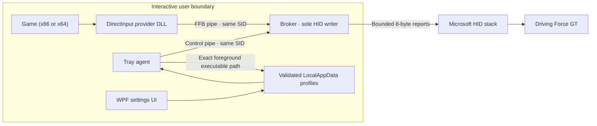
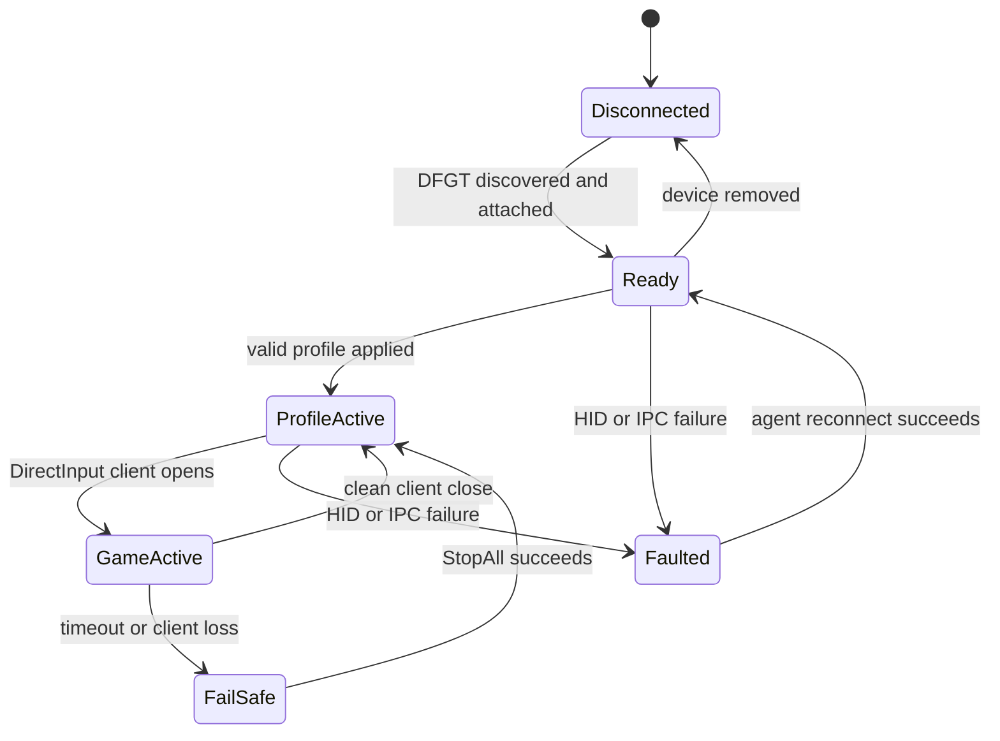

# Architecture and trust boundaries

DFGT Control restores DirectInput force feedback for the Logitech Driving Force
GT without replacing Logitech's legacy kernel filters with another kernel
driver.

| Component | Privilege | Input considered untrusted | Failure behaviour |
|---|---:|---|---|
| DirectInput provider | User | Game effect parameters | Clamp/reject; disconnect stops force |
| Broker | User | Both local IPC protocols, HID input | Reject malformed messages; `StopAll` |
| Agent | User | Profiles and foreground process path | Keep last valid profile; reconnect |
| UI | User | Human-entered profile data | Bounded validation and atomic save |
| Migration scripts | Administrator | Local driver/registry state | Backup first; stop on mismatched state |

## Runtime state

## Persistent data

`%LOCALAPPDATA%\DfgtControl\profiles.json` uses schema version 1. It contains at
most 256 profiles. Each profile has a safe identifier, display name, optional
absolute executable path, range of 40–900 degrees, overall/effect gains of
0–10000 and boundary force of 0–5000. Saves use a temporary file followed by an
atomic replacement.

No profile or device information leaves the machine.

## IPC contracts

Both protocols use fixed-size versioned messages and message-mode named pipes.
The security descriptor grants the current user read/write access and SYSTEM
and administrators full access. Remote clients are rejected.

- FFB pipe: game/provider lifecycle, force rendering, conditions, range and
  heartbeat.
- Control pipe: attach/detach, profile application, status and emergency stop.

## Failure analysis

| Failure | Detection | Required result |
|---|---|---|
| Game crashes | Pipe disconnect/heartbeat loss | Stop every effect immediately |
| Agent crashes | Control disconnect | Game force remains bounded; broker lives |
| Broker crashes | Agent status poll fails | Relaunch broker and reattach |
| Wheel disconnects | HID operation fails | Close handles; report disconnected |
| Invalid profile | Schema/range validation fails | Do not apply unbounded values |
| Malformed IPC | Magic/version/size validation fails | Reject without HID write |
| UI is closed | No dependency | Agent and FFB continue normally |
| HVCI is enabled | No custom kernel code | Runtime remains compatible |

## Release test matrix

| Scenario | Input | Expected | Type | Priority |
|---|---|---|---|---:|
| Protocol vectors | Known valid/invalid frames | Exact reports; invalid rejected | Unit | P0 |
| x64 provider | COM load and DirectInput open | Provider loads and broker responds | Integration | P0 |
| x86 provider | COM load and DirectInput open | Provider loads and broker responds | Integration | P0 |
| Client loss | Active bounded effect then process kill | Immediate `StopAll` | Physical | P0 |
| Broker restart | Terminate broker under agent | Agent relaunches and reattaches | E2E | P0 |
| Profile bounds | Values outside documented ranges | Save/apply rejected | Unit | P0 |
| Range boundary | 40° and 900° | Correct inward resistance and restoration | Physical | P0 |
| Periodic gain | Same sine at 100% and 25% | Approximately fourfold difference | Physical | P1 |
| Clean install | Microsoft HID-bound DFGT | Input and x86/x64 FFB available | E2E | P0 |
| Upgrade | Previous project release | Settings retained; binaries replaced | E2E | P1 |
| Uninstall | Valid install manifest | Owned files/keys removed only | E2E | P0 |

Physical tests are release evidence but are never run unattended in CI.
