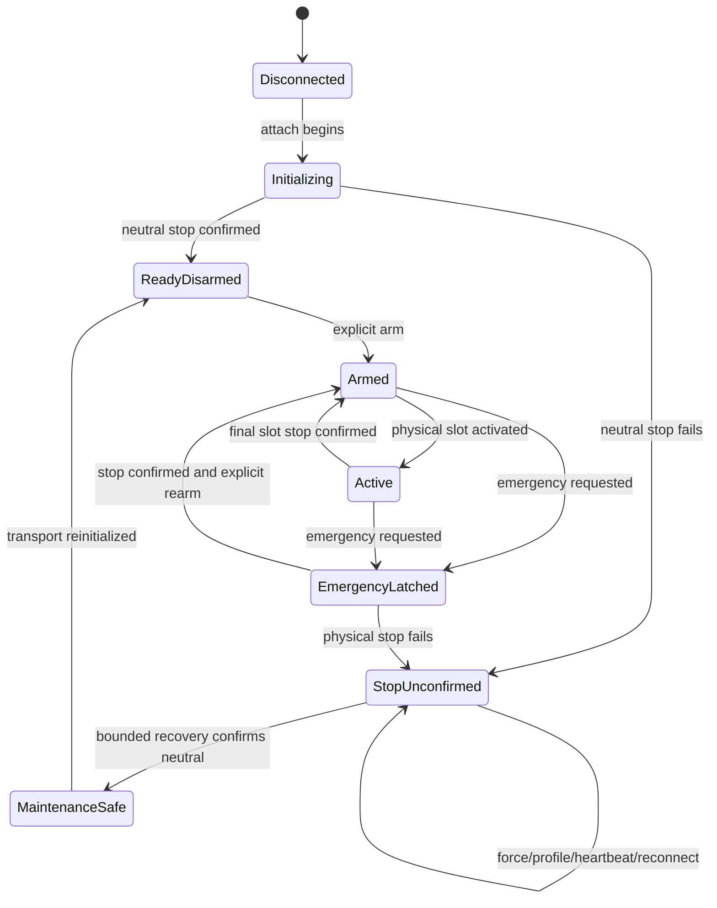

# Safety state machine

The safety state is broker-owned and outlives individual FFB/control pipe
sessions. A game, heartbeat, profile change or agent restart cannot clear an
emergency latch or an unconfirmed stop.

## Invariants

| Invariant | Enforcement |
|---|---|
| Emergency is latched before physical I/O starts | State transition precedes stop sequence |
| Emergency never auto-rearms | Only `AcknowledgeAndRearm` may leave the latch |
| Failed stop blocks all force | `StopUnconfirmed` returns a stable failure |
| Stop status is not inferred from intent | `stopConfirmed` changes only after transport confirmation |
| Slots are independent | Software, spring, damper/inertia, friction and boundary use distinct bits |
| Software zero is slot-local | It clears software only and leaves condition bits intact |
| Disconnect cannot erase safety evidence | Latch and unconfirmed-stop survive session disconnect |

## Stable failures

- `DFGT_E_EMERGENCY_LATCHED`: force rejected because emergency remains latched.
- `DFGT_E_STOP_UNCONFIRMED`: required physical stop was not confirmed.
- `DFGT_E_NOT_ARMED`: force requested outside an armed state.
- `DFGT_E_TRANSPORT_FAULTED`: rearm refused because transport/neutrality is not
  healthy.

The initial unit model is deliberately transport-independent. Production broker
integration must use the same transitions and add bounded physical stop
retries; unit success alone does not complete any physical P0 criterion.
